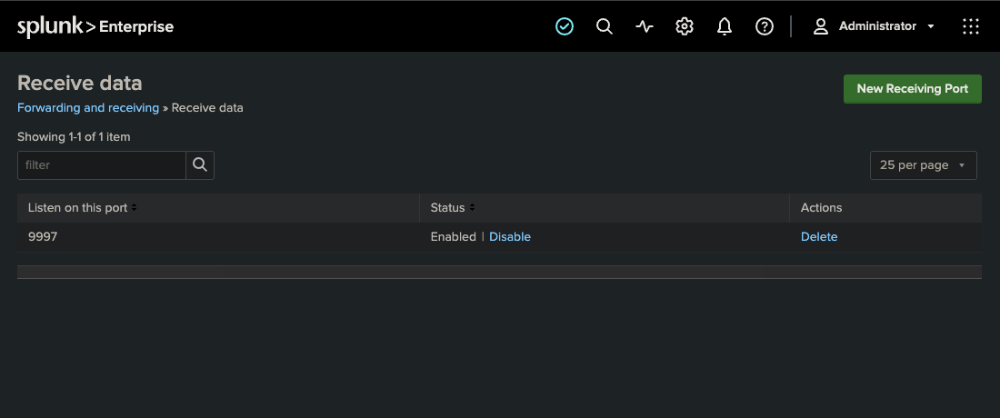
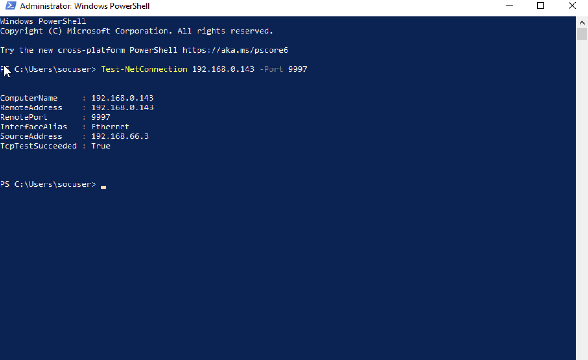
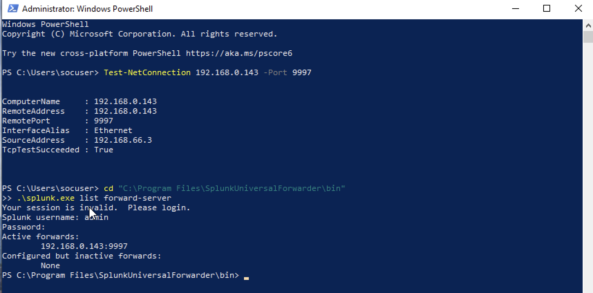
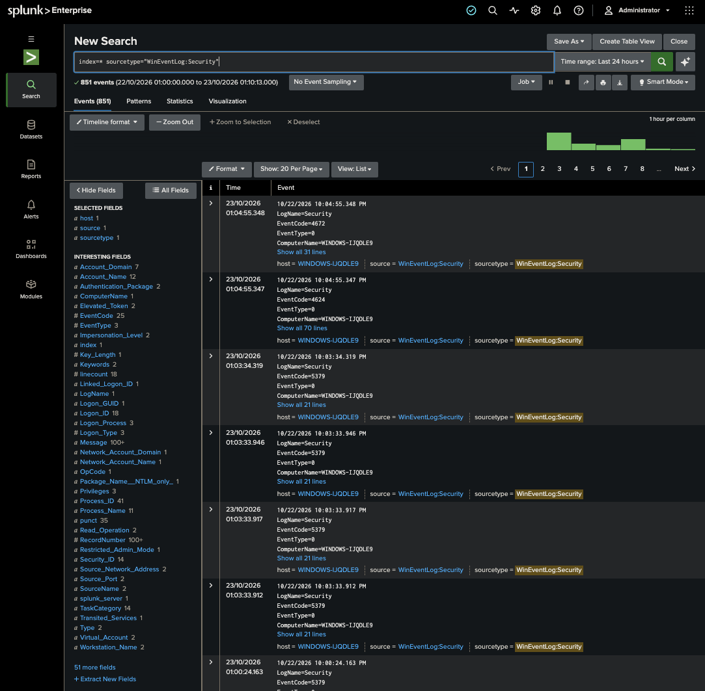
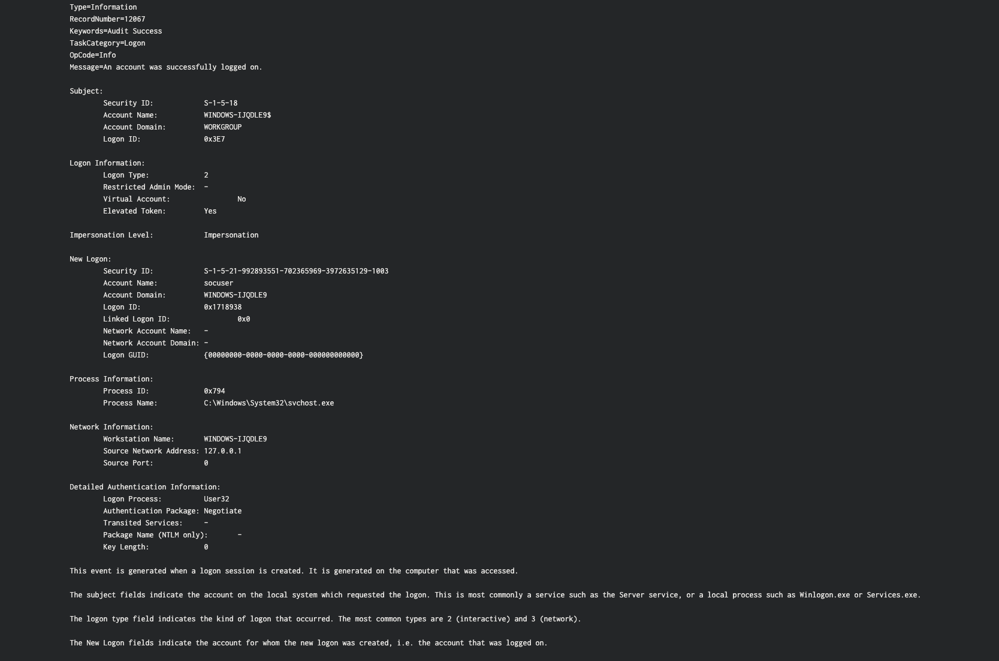
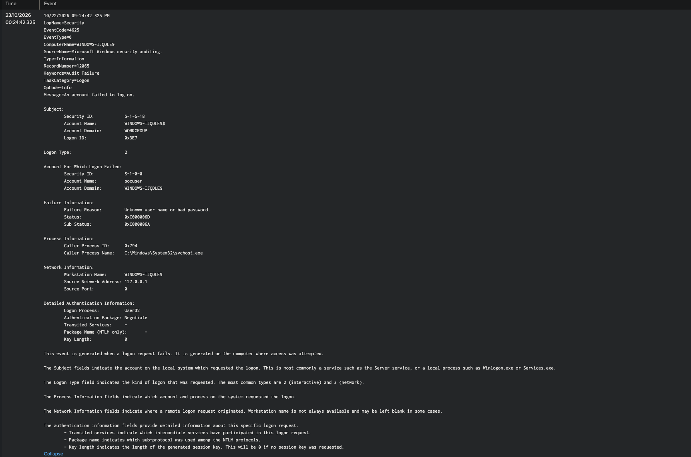

# Splunk Windows Event Log Lab

## Project Overview

This lab demonstrates how to collect and analyze Windows Security Event Logs using Splunk Enterprise.

A Windows endpoint running inside UTM was configured with the Splunk Universal Forwarder. The forwarder sends Windows Security logs to Splunk Enterprise running on the host Mac, where the events can be searched and analyzed.

The goal of this project was to understand the basic SIEM workflow:

```text
Windows activity
→ Windows Event Log
→ Splunk Universal Forwarder
→ Splunk Enterprise
→ Search and Analysis
```

---

## Lab Architecture

- **Host:** macOS
- **Virtualization:** UTM
- **Endpoint:** Windows 10 x64
- **SIEM:** Splunk Enterprise
- **Log collector:** Splunk Universal Forwarder
- **Log source:** Windows Security Event Log
- **Splunk receiving port:** TCP 9997

---

## Tools Used

- Splunk Enterprise
- Splunk Universal Forwarder
- Windows PowerShell
- Windows Event Logs
- UTM

---

## 1. Configure Splunk to Receive Forwarded Data

Splunk Enterprise was configured to listen for incoming forwarder traffic on TCP port **9997**.



This port acts as the receiving point for logs sent by the Windows Universal Forwarder.

---

## 2. Verify Network Connectivity

Before relying on the forwarder, connectivity between the Windows VM and Splunk was tested with PowerShell:

```powershell
Test-NetConnection 192.168.0.143 -Port 9997
```

The test returned:

```text
TcpTestSucceeded : True
```



This confirmed that the Windows endpoint could reach the Splunk server on TCP port 9997.

---

## 3. Configure the Splunk Universal Forwarder

The Splunk Universal Forwarder was installed on the Windows endpoint and configured to send logs to the Splunk Enterprise instance.

The configured forwarding destination was verified with:

```powershell
cd "C:\Program Files\SplunkUniversalForwarder\bin"
.\splunk.exe list forward-server
```

The active forwarding destination was:

```text
192.168.0.143:9997
```



---

## 4. Collect Windows Security Events

The Universal Forwarder was configured to monitor the Windows Security log using the following input:

```ini
[WinEventLog://Security]
disabled = 0
```

After restarting the forwarder, Windows Security events began arriving in Splunk.

The logs were verified with:

```spl
index=* sourcetype="WinEventLog:Security"
```



This confirmed that the complete logging pipeline was functioning correctly.

---

## 5. Analyze a Successful Logon

A successful Windows logon can generate **Event ID 4624**.

The following search was used:

```spl
index=* sourcetype="WinEventLog:Security" EventCode=4624
```

One event showed:

```text
Account Name: socuser
Logon Type: 2
```

Logon Type 2 represents an interactive local logon.



This demonstrates how a SOC analyst can identify which account logged in, on which endpoint, and what type of logon occurred.

---

## 6. Analyze a Failed Logon

A failed Windows logon can generate **Event ID 4625**.

The following search was used:

```spl
index=* sourcetype="WinEventLog:Security" EventCode=4625
```

The event showed:

```text
Account Name: socuser
Failure Reason: Unknown user name or bad password
Logon Type: 2
```



This type of event can be useful for investigating failed authentication attempts, password guessing, and unusual login activity.

---

## Key Takeaways

This lab reinforced the basic SIEM workflow:

- Configure a log source
- Verify network connectivity
- Forward endpoint logs to a centralized SIEM
- Confirm successful log ingestion
- Search Windows Security events
- Analyze successful and failed authentication activity

The main lesson was not memorizing every Windows Event ID, but understanding how to search, interpret, and investigate events inside a SIEM.

---

## Skills Demonstrated

- Splunk Enterprise
- Splunk Universal Forwarder
- SIEM fundamentals
- Windows Event Log analysis
- Log ingestion
- Network troubleshooting
- PowerShell
- Authentication event analysis
- Basic SOC investigation

---

## Status

✅ **Completed**
